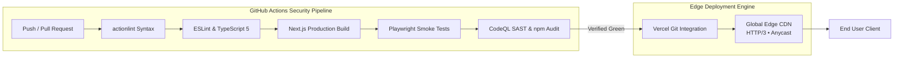

<div align="center">

```text
  ██████╗ ██╗███╗   ██╗██╗  ██╗███╗   ███╗██╗███╗   ██╗██╗  ██╗
  ██╔══██╗██║████╗  ██║██║  ██║████╗ ████║██║████╗  ██║██║  ██║
  ██████╔╝██║██╔██╗ ██║███████║██╔████╔██║██║██╔██╗ ██║███████║
  ██╔══██╗██║██║╚██╗██║██╔══██║██║╚██╔╝██║██║██║╚██╗██║██╔══██║
  ██████╔╝██║██║ ╚████║██║  ██║██║ ╚═╝ ██║██║██║ ╚████║██║  ██║
  ╚═════╝ ╚═╝╚═╝  ╚═══╝╚═╝  ╚═╝╚═╝     ╚═╝╚═╝╚═╝  ╚═══╝╚═╝  ╚═╝
```

### **Systems Engineering Showcase & ThinkAI Studio Portfolio**

*Architected for zero-trust delivery, bare-metal reliability, and 0px editorial precision.*

[](https://thinkai.id.vn)
[](https://github.com/bnhminh1010/portfolio/actions/workflows/quality.yml)
[](https://github.com/bnhminh1010/portfolio/actions/workflows/security.yml)
[](https://thinkai.id.vn)
[](./.nvmrc)
[](./DESIGN.md)

<p align="center">
  <a href="https://thinkai.id.vn">ThinkAI Studio</a> •
  <a href="/cv">DevOps CV (PDF)</a> •
  <a href="https://hostdeck.thinkai.id.vn">HomeLab Dashboard</a> •
  <a href="#%EF%B8%8F-architecture--delivery-pipeline">Architecture</a> •
  <a href="#-design-system--visual-taste-tai-ui">Design System</a>
</p>

---

</div>

## ⚡ Overview & Executive Pitch

Welcome to the source repository for **ThinkAI Studio — Engineering Showcase & Product Portfolio**. 

This platform serves as the premier studio showcase:
1. **Studio Product Portfolio:** Full architectural case studies for flagship studio products: **ThinkAI UI** (decentralized CLI component registry), **Wind** (commissioned 3D poetry reader & teaching archive with zero-asset procedural Web Audio), **HostDeck** (self-hosted operations workbench over Tailscale mesh), and **ThinkAI** (K3s GitOps delivery pipeline).
2. **Technical Craft & Motion:** An infrastructure-grade aesthetic defined by **10px precision geometry**, Obsidian depth (`#08080a`), scoped warm paper contrast (`.tai-paper`), Three.js procedural noise caustics, and a synchronized dual motion stack (**Motion 13 + GSAP 3.15 ScrollTrigger/InertiaPlugin + Lenis 1.3**).
> **Philosophy:** *“Engineering systems that are easier to ship, operate, observe, and recover.”*

---

## 🌐 Production Endpoints & Case Studies

| Target Endpoint | Classification | Core Stack | Security & Ingress Model |
| :--- | :--- | :--- | :--- |
| [**/**](https://thinkai.id.vn) | Studio Showcase | Next.js 16, React 19, Tailwind v4, Three.js, GSAP 3.15 | Vercel Global Edge, Zero Runtime Secrets, Static Caching |
| [**/products/[slug]**](https://thinkai.id.vn/products/wind) | Case Studies (4 Products) | Next.js SSG, Prose Paginator, Procedural Web Audio | Static Site Generation, Verifiable Git Ledgers, Zero Secrets |
| [**/about**](https://thinkai.id.vn/about) | Studio Profile & Principles | React 19, Tailwind v4, Motion 13 | Static SSG, Direct Contact & Verification |
| [**/cv**](/cv) | DevOps Resume (PDF) | PDF.js / Stream Engine | Single-Page Direct Stream, Canonical PDF Source |
---

## 🏗️ Architecture & Delivery Pipeline

### 1. Bare-Metal Homelab (HostDeck) Operations Architecture
HostDeck manages a 9-service bare-metal container fleet using rootless Podman over a zero-exposure Tailscale mesh.

```
┌─────────────────────────────────────────────────────────────┐
│               Private Tailscale Mesh (WireGuard)            │
│               [ Encrypted Peer-to-Peer Transit ]            │
└──────────────────────────────┬──────────────────────────────┘
                               │
                               ▼
┌─────────────────────────────────────────────────────────────┐
│                 Bare-Metal Host Environment                 │
│  ┌───────────────────────────────────────────────────────┐  │
│  │ Hardened Host-Agent & Go Operations Server            │  │
│  │ • SQLite WAL Time-Series     • PTY Web Terminal       │  │
│  │ • systemd Watchdog Guard     • ZRAM & OOM Supervisor  │  │
│  └───────────────────────────┬───────────────────────────┘  │
│                              │ Rootless Socket API          │
│                              ▼                              │
│  ┌───────────────────────────────────────────────────────┐  │
│  │ 9x Containerized Services (Podman Engine)             │  │
│  │ [Redis]  [PostgreSQL]  [ThinkAI API]  [Auth Daemon]   │  │
│  └───────────────────────────────────────────────────────┘  │
└─────────────────────────────────────────────────────────────┘
```

### 2. Portfolio Edge Delivery & Zero-Trust CI/CD Pipeline



---

## 🎨 Design System & Visual Taste: `tai-ui`

Built on the **ThinkAI Studio Design Specification** ([`DESIGN.md`](./DESIGN.md)):

* **10px Precision Geometry:** 10px border-radius (`rounded-[10px]`) for cards/buttons/inputs, 16px (`rounded-[16px]`) for large containers, and `0 0 16px 16px` for section exit tucks.
* **Obsidian Depth & Scoped Paper Contrast:** Deep hắc thạch base canvases (`#08080a`, `#0d0d10`, `#131316`) contrasted with ONE scoped warm paper section (`.tai-paper`) reserved exclusively for the Wind literary platform.
* **Dual Motion Engine & Sora UI:** Synchronized Lenis 1.3 momentum scrolling, GSAP 3.15 ScrollTrigger (Hero tuck, 3.5° card fan deck), and Sora UI interactive components (`@soralabs`).
* **WCAG AAA Reduced-Motion Engine:** Full 4-tier motion accessibility (`Bail`, `Snap-to-End`, `Collapse`, `Reduce`) guaranteeing zero vestibular triggers.
* **Component Registry (`thinkai-ui`):** Modern registry-first UI distribution model ([`registry/registry.json`](./registry/registry.json)), installable directly into external projects via `npx thinkai-ui`.

---

## 🛠️ Technology Matrix

```
HURDLE: INFRASTRUCTURE & BACKEND        CRAFT: INTERFACE & EXPERIENCE
├── Go (Golang) / Spring Boot (Java 21) ├── Next.js 16 (App Router / Turbopack)
├── Rootless Podman & Docker Engine      ├── React 19 + React Compiler
├── Kubernetes (K3s) & Argo CD GitOps    ├── Tailwind CSS v4 + 10px Precision System
├── Tailscale WireGuard Mesh Networking  ├── Three.js WebGL & Lenis 1.3 Smooth Scroll
└── SQLite (WAL) / PostgreSQL / Supabase └── Motion 13 + GSAP 3.15 + Sora UI Registry

---

## 🚀 Local Engineering Setup

### Prerequisites
* **Node.js:** `>= 24.0.0 < 25.0.0` (Use [`.nvmrc`](./.nvmrc))
* **Package Manager:** `npm` (Lockfile frozen)

### Quick Start
```bash
# 1. Clone repository
git clone https://github.com/bnhminh1010/portfolio.git
cd portfolio

# 2. Match Node version
nvm use

# 3. Clean install exact lockfile dependencies
npm ci

# 4. Start local development server (Turbopack enabled)
npm run dev
```
Open [http://localhost:3000](http://localhost:3000) to view the live workspace.

### Quality & Verification Commands
```bash
# Run strict TypeScript compilation check
npm run typecheck

# Execute Next.js production build
npm run build

# Run Playwright E2E browser smoke suite
npm run test:smoke

# Build and sync the thinkai-ui registry
npm run registry:build
```

---

## 🛡️ Security & Engineering Controls

- **Trust Boundary Policy:** The public site contains zero operational secrets, database connectors, or live infrastructure credentials. All architecture diagrams are strictly demonstrative.
- **Vulnerability Disclosure:** Please review [`SECURITY.md`](./SECURITY.md) before submitting reports. Direct emails to `pata10102004@gmail.com`.
- **Runbooks & Operational Architecture:** Detailed in [`docs/architecture.md`](./docs/architecture.md) and [`docs/runbooks/`](./docs/runbooks/).

---

## 📄 License & Attribution

- **Source Code:** Released under the [MIT License](./LICENSE).
- **Design Language:** Copyright © 2026 **ThinkAI Studio / Nguyen Huu Binh Minh**. Inspired by high-craft editorial design systems (Linear, Vercel).
